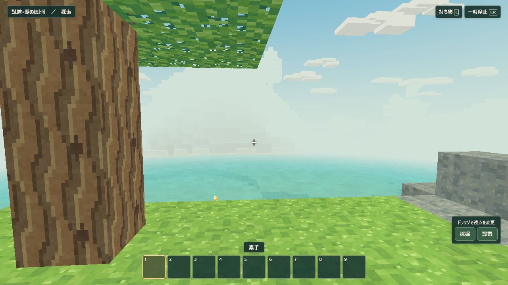
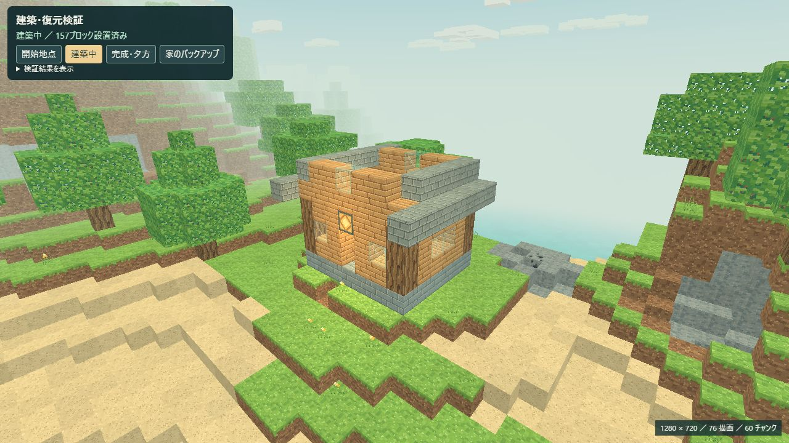
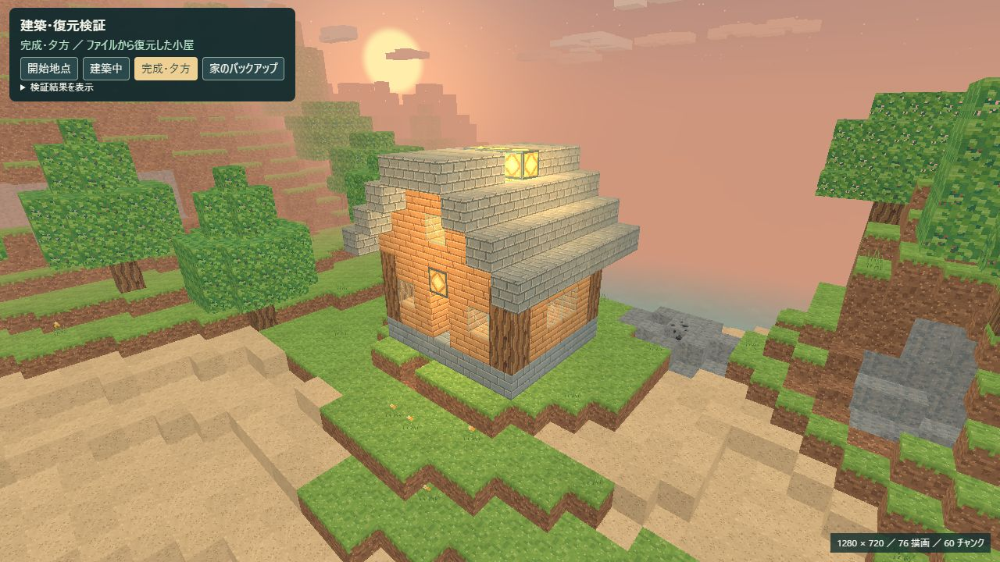
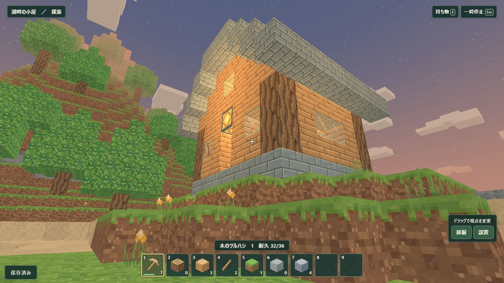

# ウェブクラフト777 初版の動作確認

このファイルは地形方式1・保存形式1の公開時の記録です。2026年11月20日の品質改修は[機能・保存の確認](QUALITY.md)と[景観・性能の比較](QUALITY-RENDER.md)をご覧ください。

探索モードで原木を掘り、作った木材を置き、保存して再開するところまで実際のゲーム画面で確認しました。最終版では探索とクリエイティブの両方を開き、保存ファイルから復元した小屋を歩いて見学できました。性能については、同じ周回をたどった際の環境ごとの実測を末尾に掲載しています。

## ゲーム画面で操作した項目

Windows のアプリ内ブラウザーで、タイトルから通常の操作画面に入って確認しました。

| 項目 | 確認した結果 |
| --- | --- |
| 新規作成 | 探索ワールドを作り、地形が表示されるところまで進めた |
| 視点操作の代替 | ドラッグによる見回しと画面上の採掘・設置ボタンで操作できた |
| 採取・クラフト | 木から原木を採掘し、持ち物画面で原木1個から木材4個を作れた |
| 建築・消費 | 木材をホットバーから1個置くと、所持数が4個から3個になった |
| 保存・再開 | 手動保存後に公開用ビルドのページを再読み込みし、「つづきから」で探索を再開。設置後の木材3個とホットバーが復元された |
| バックアップの読み込み | 通常の「ファイルを読み込む」で同梱の `examples/lakeside.json` を選んだ。既存の探索ワールドとともに小屋が一覧に現れ、実際に小屋を見回せた。木のツルハシは耐久32/36、石レンガは4個と表示された |
| クリエイティブ | 新規ワールドでF、Space、Wを使い、高さ39.9まで上昇して前進できた。数字9で灯晶ブロックを選び、Eの一覧で同じ枠を砂に変更できた。個数表示は無制限だった |
| 画質変更 | 描画設定の変更後も景色とデバッグ表示を確認できた。計測値は下表のとおり |

## WebGL と IndexedDB を使った建築シナリオ

開発サーバーで `/tests/scenario.html` を開き「3場面を準備する」を押すと再現できます。専用ワールドでスクリプトがカメラを配置し、ゲームと同じ衝突・照準・編集・所持品・クラフトの処理を呼びます。プレイ画面から手で家の全ブロックを置いた試験と区別しています。

| 項目 | 実行した操作と結果 |
| --- | --- |
| 移動 | 実物の地形上で歩行・ダッシュ・ジャンプを入力し、移動量と足元の高さの変化を検査 |
| 探索 | 原木・石・地表の計7ブロックを採掘。木のツルハシを作って石を4ブロック掘り、耐久が36から32に減った。丸石4個から石レンガ4個を制作 |
| 建築 | クリエイティブの設置処理で、5ブロック以内の面に木材・原木・石レンガ・ガラス・照明など208個を置いた。建物はX=128とZ=144のチャンク境界をまたぐ |
| 復元 | IndexedDB に保存して読み出し、バックアップと同じ JSON に変換。形式を検証して別のテスト用 IndexedDB に取り込み、新しいワールドをシードから生成した。家の全建材、掘った穴、所持品と耐久、位置と向きが一致 |
| 景観 | 生成時の開始地点、157個設置した建築途中の小屋、バックアップから復元した夕方の小屋を WebGL で表示 |

ダウンロード可能な小屋の JSON は、この検証ページの「家のバックアップ」から取得できます。次の画像は実際に描画したゲーム画面です。

最終版の通常のプレイ画面で、同じ家を地上から眺めた場面です。ホットバーには読み込んだ道具と素材が表示されています。

## 自動テスト

`npm test` で **31件成功、失敗0件**。保存処理の単体テストにはテスト用の IndexedDB 実装を使い、上記シナリオではブラウザーの IndexedDB を使いました。

| テストファイル | 件数 | 検証対象 |
| --- | ---: | --- |
| `tests/physics.test.ts` | 9 | 歩行・ダッシュ・斜め移動、床・壁・天井、低フレーム時の衝突、足元の採掘と落下、水中での移動・浮上、5ブロックの射程、体と重なる設置の禁止、安全な復帰 |
| `tests/inventory.test.ts` | 6 | 原木から道具・建材までの制作、連続操作、満杯時の取り消し、道具の破損・予備道具の耐久、ホットバー、保存された数量の検証 |
| `tests/world.test.ts` | 6 | 整数座標と境界、岩盤、シード再現性、スポーン周辺の資源、空気への変更保存、チャンク境界をまたぐ露出面と周囲の陰影の再構築 |
| `tests/storage.test.ts` | 3 | 書き込み完了後の再接続・再読込、JSON 復元、同名ワールド・同時書き込み、破損ファイル・非対応バージョンの拒否 |
| `tests/scenario.test.ts` | 1 | 二つのチャンク境界をまたぐ小屋と掘った穴が、地形の再生成後にも一致 |
| `tests/input.test.ts` | 6 | 実装の入力ハンドラにフォーカス喪失・タブの非表示・視点固定の許可／拒否／無応答・遅延解除を模擬。再開後に移動・ダッシュ・採掘の押下状態が残らないことを確認 |

## 性能計測

### 描画調整前の10分間計測

Windows の Chrome で開発用の `/tests/soak.html` を開き、シード `777-SOAK` で同じ周回路をたどりました。描画面は **2048×1017ピクセル、描画距離3チャンク、解像度倍率1、影なし**。非表示扱いのタブは計測から除外しました。OS上で Chrome ウィンドウが最前面を維持していたか、GPUやブラウザーがどの程度スロットリングしたかは未確認です。

| 分 | 1 | 2 | 3 | 4 | 5 | 6 | 7 | 8 | 9 | 10 |
| --- | ---: | ---: | ---: | ---: | ---: | ---: | ---: | ---: | ---: | ---: |
| 区間平均 FPS | 1.1 | 1.0 | 1.0 | 1.0 | 1.3 | 1.0 | 1.0 | 1.0 | 1.0 | 1.0 |

- 実測時間 **600.7秒**。12の水平チャンクを通り、設置40回・採掘41回が成功しました。開始時に掘った穴も維持されました。
- 描画回数は1フレームあたり5〜78回、表示チャンク数は3〜62。GPUジオメトリ数は全体で84〜127個、最後の1分で85〜123個でした。
- Chrome が報告した JavaScript ヒープ使用量の範囲は、最初の1分が22〜35 MiB、最後の1分が29〜47 MiBでした。GPUジオメトリ数の最終範囲は全体の範囲内に収まっています。ヒープ使用量の始点と終点だけでは、長時間のメモリリークの有無を断定できません。

### 描画調整前の短時間の表示値

アプリ内ブラウザー、1280×720ピクセルの画面で、開始地点の F3 表示を読み取りました。標準設定で **60 FPS・描画56回・表示38チャンク**、影オン・解像度倍率0.95で **60 FPS・描画49回・表示33チャンク** でした。これはそれぞれ一時点の表示値です。上の Chrome 周回試験とはブラウザー、画面サイズ、場面、サンプリング時間が異なります。

### 最終版の10分間計測

Windows、NVIDIA GeForce RTX 5080、ANGLE / Direct3D 11。シード `777-SOAK`、描画距離3、解像度倍率1、影オフ。同じ周回コースを昼夜の変化とともに進み、通常の照準・設置・採掘処理を呼び出しました。最終版は標準の内部解像度を約120万画素までに調整し、不透明な地形の裏の空の描画を省いています。

| 計測条件 | Windows アプリ内ブラウザー | デスクトップ Chrome 157.0.8103.79 |
| --- | ---: | ---: |
| 内部の描画解像度 | 1280×720 | 1554×772 |
| タブの非表示時間を除く計測時間 | 600.0秒 | 601.0秒 |
| 1分ごとの平均 FPS | 59.9、以降9区間は60.0 | 1.1、続く8区間は1.0、最後は1.2 |
| 1フレームの描画回数／表示チャンク数 | 6〜78回／4〜62 | 5〜78回／3〜62 |
| 形状数（最後の1分） | 87〜127 | 86〜123 |
| JSヒープ（最初の1分 → 最後の1分） | 21〜48 → 26〜42 MiB | 22〜37 → 22〜33 MiB |
| 設置／採掘／編集失敗 | 40／41／0 | 40／41／0 |

両環境で12の水平チャンクを通過し、最初に掘った穴が残りました。アプリ内ブラウザーでは10分の間に速度が落ち込む傾向は見られず、2分目以降の形状数は同じ範囲を繰り返しました。JSヒープは増減しており、10分を超えるプレイやGPUメモリ全体の推移は未測定です。

Chrome はブラウザー制御下のタブで、低いほぼ一定の FPS が続きました。両環境ともページが報告したフォーカス率は100%ですが、OS上のウィンドウの前面状態とは別の指標です。Chromeのバックグラウンド制御・同時に動く描画・通常プレイ時の速度差を切り分けていないため、この測定から一般のChromeでのFPSは推定できません。

### 公開用ビルドと画面サイズ

- Node.js 24.22.1 で型検査と Vite の公開用ビルドに成功しました。`play/` を `/webcraft777/play/` に静的配信し、ゲーム本体、スタイル、アイコン、タイトル画像、Three.jsライセンスの内容がビルドと一致することを確認しました。
- 通常の Chrome でもタイトルから新規ワールドを作り、「プレイ開始」後にドラッグ操作のHUDが表示され、Escで一時停止画面を開けました。
- 800×450 のアプリ内ブラウザーでは設定を縦にスクロールでき、全スライダーの幅と9枠のホットバーが画面内に収まりました。プレイ中に1280×720へ戻すと内部描画サイズも追随しました。

### 確認範囲の補足

Edge 本体での通しプレイ、独立ウィンドウで実際に許可されたマウス固定、スピーカーからの効果音の聴感、バックアップのダウンロード先フォルダーへの着地は未確認です。マウス固定拒否時のプレイと実ファイルの読み込みはブラウザーで、マウス固定の許可・解除・タブ切り替えでの押下解除は入力テストで確認しました。低性能・内蔵GPU環境は未計測です。
