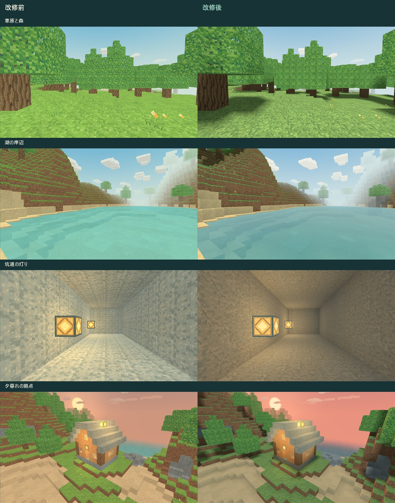

# ウェブクラフト777　景観と性能の比較

## 4つの同じ場面

旧形式の湖畔の小屋を種「777-SOAK」から復元した。床や木の位置、カメラ、時刻、描画距離と解像度をそろえている。坑道には両版で同じ通路を掘り、同じ位置に暖色の灯晶を2個置いた。草地は草と土の境目、湖畔は水深と岸、坑道は灯りから遠ざかる壁、夕方は木組みと石の陰影を比較できる。

| 場面 | 改修前の原寸 | 改修後の原寸 |
|---|---|---|
| 草原・森 | [画像](screenshots/quality/before-forest.jpg) | [画像](screenshots/quality/after-forest.jpg) |
| 岸辺 | [画像](screenshots/quality/before-shore.jpg) | [画像](screenshots/quality/after-shore.jpg) |
| 坑道 | [画像](screenshots/quality/before-cave.jpg) | [画像](screenshots/quality/after-cave.jpg) |
| 夕暮れの家 | [画像](screenshots/quality/before-cottage.jpg) | [画像](screenshots/quality/after-cottage.jpg) |

新規ワールドでは、水中、ガラス越しの入江、夜の家、2色の坑道照明も別に撮影した。[新しい地形の実画面](screenshots/expedition-views.jpg)

各ブロック面を32×32画素で描き、草・土・石の柄はシードと座標から選ぶ。原木の年輪と木目は保存された軸に追随する。模様の外側16画素に端の色を伸ばし、距離に応じた縮小で隣の素材が混ざるのを抑えた。色の画像をsRGBから線形色へ読み、隅の陰影、太陽、最大4個の灯りを適用して、画面出力時にsRGBへ戻す。影は地形の高さを基に近距離へ計算し、編集した柱の高さを即座に反映する。水面とガラスは同じチャンクでも別々の範囲で描画順を決める。

最初の撮影で、ポーズ中に坑道へカメラを移すと灯晶の面だけが明るく、壁の光が移動前のまま残ることが分かった。カメラが2ブロックを超えて移動した時にも近い灯りを選び直すように修正し、同じ坑道で壁・床・天井の照り返しを再確認した。

## 測定条件

Windows、AMD Ryzen 7 9800X3D、Chrome 157 ヘッドレス、ANGLE Direct3D 11、NVIDIA GeForce RTX 5080。表示領域は1920×1080、デバイス倍率1。各場面を60秒ずつ描画し、連続する requestAnimationFrame の間隔を集計した。平均FPSはフレーム数÷経過秒数。パーセンタイルは小さい順に並べた実フレーム間隔から求めた。

旧版との同条件比較は描画距離3、倍率1、近距離の影オフ。旧版のピクセル上限に合わせ、両方とも内部1460×821で描画した。標準設定は距離3、倍率1、近距離の影・植生・追加効果オン、内部1920×1080。標準試験は手元の斧・灯り・ブロックと、設置予告・採掘のひびも描画する。HUD・音声はこの描画シナリオの対象外。

## 通常プレイ中のフレーム間隔

通常時の標準設定は、手元の道具・破片・設置予告・ひびを一度描画した第2周から採った。旧版と同条件の値は地形とカメラを準備した後の各60秒を使う。初回起動とエフェクト表示の確認は[機能検証](QUALITY.md)にも記録した。

| 版・設定 | 場面 | 平均FPS | 中央値 ms | P95 ms | P99 ms |
|---|---|---:|---:|---:|---:|
| 旧版 | 森の移動 | 31.9 | 31.3 | 31.7 | 32.0 |
| 旧版 | 坑道の移動 | 32.0 | 31.3 | 31.7 | 32.0 |
| 旧版 | 連続設置・採掘 | 31.9 | 31.3 | 31.7 | 32.2 |
| 改修版・同条件 | 森の移動 | 30.8 | 31.3 | 31.6 | 31.7 |
| 改修版・同条件 | 坑道の移動 | 32.0 | 31.3 | 31.6 | 31.7 |
| 改修版・同条件 | 連続設置・採掘 | 32.0 | 31.3 | 31.6 | 31.7 |
| 改修版・標準 | 森の移動 | 32.0 | 31.3 | 31.8 | 32.1 |
| 改修版・標準 | 坑道の移動 | 32.0 | 31.3 | 31.8 | 32.0 |
| 改修版・標準 | 連続設置・採掘 | 32.0 | 31.2 | 31.8 | 32.1 |

| 版・設定 | 場面 | 描画回数 | 三角形数 | 表示チャンク数 | 更新待ち | チャンク更新 P95 / 最大 ms | geometry数 | texture数 |
|---|---|---:|---:|---:|---:|---:|---:|---:|
| 旧版 | 森の移動 | 50–76 | 40488–62618 | 36–62 | 0–23 | 0.00 / 4.90 | 79–102 | 2 |
| 旧版 | 坑道の移動 | 45–66 | 41564–58222 | 37–54 | 0 | 0.00 / 0.10 | 100–102 | 2 |
| 旧版 | 連続設置・採掘 | 27 | 24696–24752 | 23 | 0–17 | 1.20 / 3.60 | 87 | 2 |
| 改修版・同条件 | 森の移動 | 50–76 | 40352–62482 | 36–62 | 0–23 | 0.00 / 3.90 | 82–105 | 2 |
| 改修版・同条件 | 坑道の移動 | 45–66 | 41684–58158 | 37–54 | 0 | 0.00 / 0.00 | 103–104 | 2 |
| 改修版・同条件 | 連続設置・採掘 | 27 | 24636–24728 | 23 | 0–16 | 1.10 / 3.70 | 89 | 2 |
| 改修版・標準 | 森の移動 | 51–77 | 40460–62590 | 36–62 | 0–15 | 0.00 / 3.90 | 90–112 | 3 |
| 改修版・標準 | 坑道の移動 | 46–67 | 41744–58218 | 37–54 | 0 | 0.00 / 0.00 | 110–111 | 3 |
| 改修版・標準 | 連続設置・採掘 | 28–29 | 24704–24800 | 23 | 0–17 | 1.10 / 3.60 | 90 | 3 |

更新時間は、そのフレームでチャンクの再構築に使ったCPU側の時間。未更新フレームを含む。geometryとtextureはWebGLRendererが管理するオブジェクトの個数で、GPUメモリ容量は未測定。GPU処理時間とフレーム全体のCPU処理時間も未測定。

## 起動と長時間試験

| 版・条件 | 地形復元と試験通路作成 ms | 描画器準備 ms | 初回のメッシュ待ち・シェーダーとGPU完了待ち ms |
|---|---:|---:|---:|
| 旧版 | 49.7 | 59.5 | 558.4 |
| 改修版・同条件 | 45.6 | 75.1 | 564.3 |

初回だけの準備は上表に分けた。JavaScript本体のダウンロード、ドライバーのディスクキャッシュ状態、シェーダー単独のコンパイル時間はこの撮影では測定していない。[4地点の位置・視線・時刻と初回準備の記録](tests/results/quality/matched-captures.json)

標準設定で同じ3場面を5周し、計900.3秒観察した。連続設置・採掘の成功1070回、失敗0回。初周と第5周の対応する場面を下に示す。

| 場面 | FPS 初周 → 第5周 | P99 ms 初周 → 第5周 | geometry数の範囲 初周 → 第5周 | texture数の範囲 初周 → 第5周 |
|---|---:|---:|---:|---:|
| 森の移動 | 32.0 → 32.0 | 32.1 → 31.7 | 60–85 → 90–112 | 2 → 3 |
| 坑道の移動 | 32.0 → 32.0 | 32.0 → 31.7 | 85–87 → 110–111 | 2 → 3 |
| 連続設置・採掘 | 32.0 → 32.0 | 32.0 → 31.7 | 88–90 → 90 | 2–3 → 3 |

初周に道具とひびの描画資源を読み込んだ後、第2〜第5周は各場面のgeometry・texture個数の範囲が毎周一致した。3場面の平均は第1周 32.0 FPS、第5周 32.0 FPS。Chromeが報告したJSヒープは全区間で 20.8〜37.2 MiBの間で増減した。 GPUメモリ容量とプロセス全体の使用量は未測定。

低画質は内部1022×575、距離2、近距離の影・植生・追加効果オフ。各10秒間の参考値は森の移動 32.0 FPS、坑道の移動 32.0 FPS、連続設置・採掘 32.0 FPS。同じChromeで描画しない5秒間の更新通知は平均32.0 FPS、中央値31.2 ms。この環境で60fpsは実証できなかった。低画質では三角形数と内部解像度を減らせる。端末やブラウザーの提示周期によって実際のFPSは異なる。

各分のFPS・P95・P99・編集回数と描画資源の推移はJSONで確認できる。[旧版](tests/results/quality/before.json) ／ [改修版の同条件](tests/results/quality/after.json) ／ [標準の15分](tests/results/quality/standard-soak.json) ／ [低画質の短時間試験](tests/results/quality/low-sample.json)

## 再現方法

開発サーバーを起動し、ゲームのURLの下で tests/comparison.html を開く。画面上の4場面の選択で撮影地点を切り替えられる。標準設定は末尾に ?shadows=1、低画質は ?preset=low を付ける。ブラウザーのウィンドウをアクティブにしたまま計測する。比較する両版に同じテストページと examples/lakeside.json を用意する。撮影座標と時刻、周回ルートは [comparison.ts](tests/comparison.ts) にある。実測中は自動再読み込みの影響を避けるため、改修版の測定ページを静的ファイルにした。
